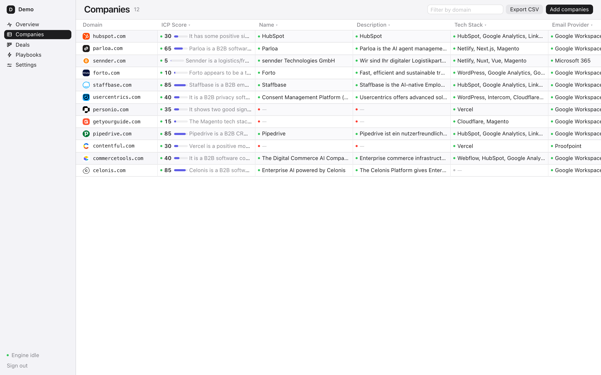
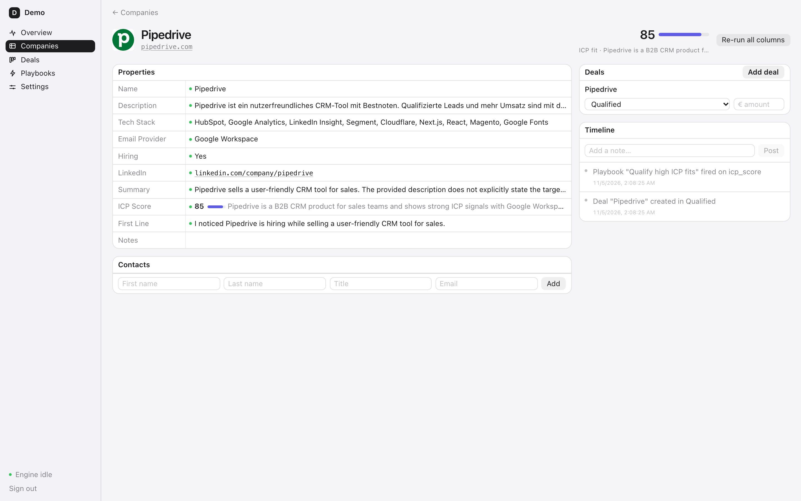
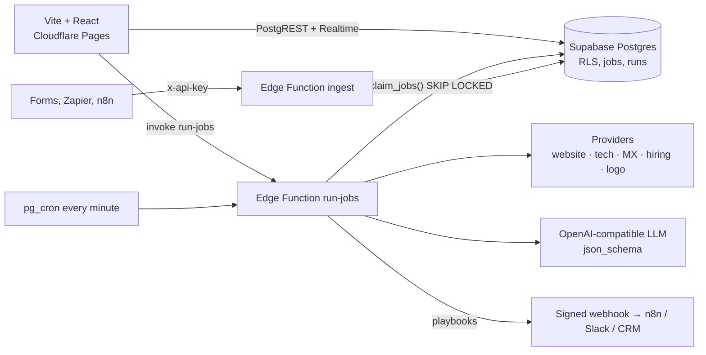
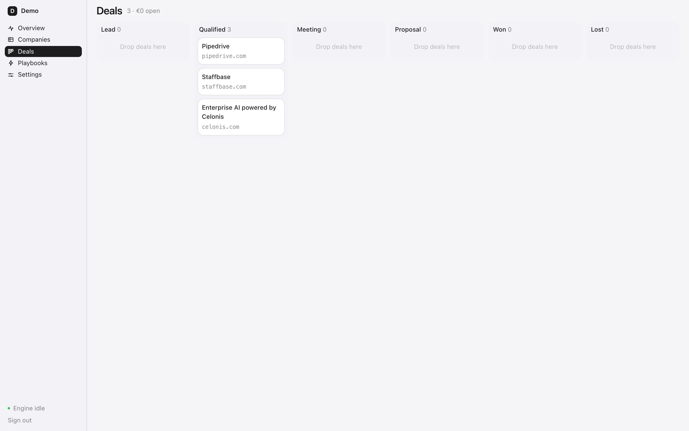
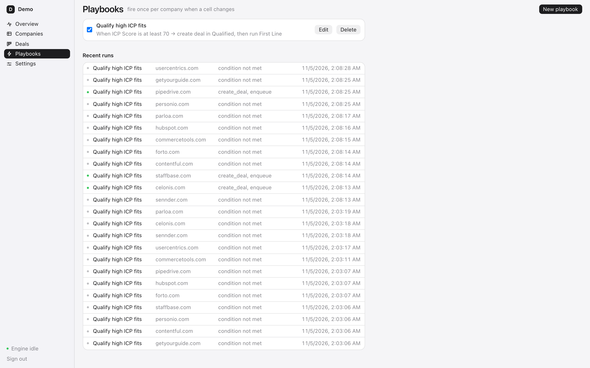

# GTM — Go-to-Market Toolkit

Clay-style enrichment tables and a HubSpot-style CRM core on **one data model**, built to show how a GTM engineer
turns a list of domains into qualified pipeline without paying for Clay.

> Paste domains → every column fills itself (website facts, tech stack, email provider, hiring signal) →
> AI columns summarise and score against your ICP → a playbook opens the deal and drafts the first line →
> a signed webhook tells n8n, Slack or your real CRM.

**Live demo:** [gtm-toolkit.pages.dev](https://gtm-toolkit.pages.dev) → "Try the demo workspace". The demo workspace is wiped daily.



## What it does

| Clay side | HubSpot side |
|---|---|
| Columns are **properties**; a property with a provider is an enrichment, one with a prompt is an AI column | Companies, contacts, deals in a pipeline with a drag-and-drop board |
| **Waterfall**: first non-empty provider wins, every cell keeps its provenance (provider, duration, tokens, raw output) | **Timeline** per company: notes, deal moves, playbook fires |
| Five free providers, no API keys: website meta, tech-stack signatures, MX-based email provider, careers-page hiring signal, logo | **Playbooks**: "when ICP score ≥ 70 → create deal in Qualified, run First line, POST a signed webhook" |
| AI columns via any OpenAI-compatible endpoint with `json_schema` answers; prompts reference other columns and are enriched in dependency order | **Inbound API** with hashed keys: `POST /functions/v1/ingest {"domains": [...]}` from forms, Zapier, n8n |
| Live cells: the table updates over Supabase Realtime while the worker runs | Overview: coverage per column, pipeline by stage, AI spend |



## Architecture



- **Supabase is the whole backend** (ADR 0001): Postgres with Row Level Security as the only authorization layer, Auth with magic links, Realtime, Edge Functions, `pg_cron`.
- **Properties are columns, companies carry the values** (ADR 0002): adding a column is one insert, every cell write is logged in `runs`.
- **The queue is a Postgres table** (ADR 0003): `claim_jobs()` with `FOR UPDATE SKIP LOCKED`, retries with backoff, stale-lock recovery; the same engine runs as an edge function in the cloud and as `npm run worker` locally.
- **Playbooks fire once per company** (ADR 0004): a partial unique index makes re-runs idempotent.

Decisions and their reasons live in [`docs/adr/`](docs/adr/) and the build log in [`docs/LOG.md`](docs/LOG.md).

## Run it locally

Requirements: Node 22+, Docker (OrbStack or Docker Desktop).

```bash
npm install
npx supabase start            # local Postgres, Auth, Realtime on :54321
cp .env.example .env          # paste the anon key from `npx supabase status`
npm run dev                   # http://localhost:5173
npm run worker                # the enrichment engine, polls the local queue
```

Sign in with any email (the link lands in Mailpit at http://127.0.0.1:54324), name a workspace, paste a few domains.
AI columns need `QWEN_BASE_URL`, `QWEN_API_KEY`, `QWEN_MODEL` in `supabase/functions/.env` (any OpenAI-compatible endpoint; they are off by default and run on demand from the column menu).

```bash
npm test            # Vitest: providers against HTML fixtures, waterfall, playbook conditions, CSV
npm run typecheck
```

## Deploy (free tier)

1. **Supabase**: create a project, add `SUPABASE_ACCESS_TOKEN`, `SUPABASE_PROJECT_REF`, `SUPABASE_DB_PASSWORD` as GitHub secrets. The `Deploy Supabase` workflow pushes migrations and edge functions on every change under `supabase/`. Set function secrets once: `npx supabase secrets set QWEN_BASE_URL=… QWEN_API_KEY=… QWEN_MODEL=… WEBHOOK_SECRET=…`.
2. **Scheduler**: run once in the SQL editor so `pg_cron` can reach the worker:
   `select vault.create_secret('https://<ref>.supabase.co/functions/v1/run-jobs', 'run_jobs_url'); select vault.create_secret('<service_role key>', 'service_role_key');`
3. **Cloudflare Pages**: `npx wrangler pages project create <name>` once, then add `CLOUDFLARE_API_TOKEN`, `CLOUDFLARE_ACCOUNT_ID`, `VITE_SUPABASE_URL`, `VITE_SUPABASE_ANON_KEY` as GitHub secrets. The `Deploy Pages` workflow builds and uploads on every push (or run `npm run build && npx wrangler pages deploy dist --project-name <name>` by hand). Add the Pages URL to Supabase Auth redirect URLs.
4. **Demo workspace** (optional): create a user in Supabase Auth, make it editor of a workspace with `is_demo = true`, set `VITE_DEMO_EMAIL` / `VITE_DEMO_PASSWORD`. Companies older than a day are swept hourly.

## The API is the database

PostgREST exposes every table under RLS, so the app's own calls are the public API:

```bash
# companies with an ICP score of 70 or more, newest first
curl "$SUPABASE_URL/rest/v1/companies?select=domain,props&props->icp_score->>score=gte.70&order=created_at.desc" \
  -H "apikey: $ANON_KEY" -H "Authorization: Bearer $USER_JWT"

# push domains in from anywhere (key from Settings → API keys)
curl -X POST "$SUPABASE_URL/functions/v1/ingest" -H "x-api-key: gtm_…" -H "content-type: application/json" \
  -d '{"domains": ["acme.de", "example.com"]}'
```

Outbound webhooks are signed: `x-gtm-signature = HMAC-SHA256(WEBHOOK_SECRET, body)`.

## Adding a provider

One file in `supabase/functions/_shared/providers/`, one test next to it, one line in the registry. A provider gets the domain, the known props and a shared homepage fetch, and returns a JSON object; columns pick a field of it with `provider.field`.

```ts
export const myProvider: Provider = {
  name: 'my_provider', fields: ['thing'], cacheHours: 24,
  async run(ctx) { const page = await ctx.page(); return { data: { thing: findThing(page.html) } } },
}
```




## Status

Working end to end locally; cloud deploy is wired but needs the owner's Supabase project and Cloudflare account. Not yet: saved views, multi-workspace switcher, contact-level enrichment.

MIT.
